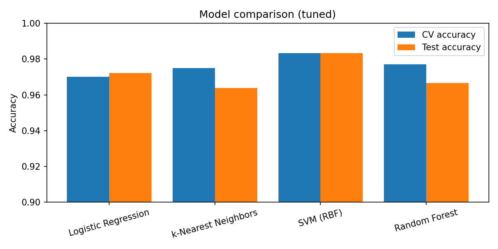
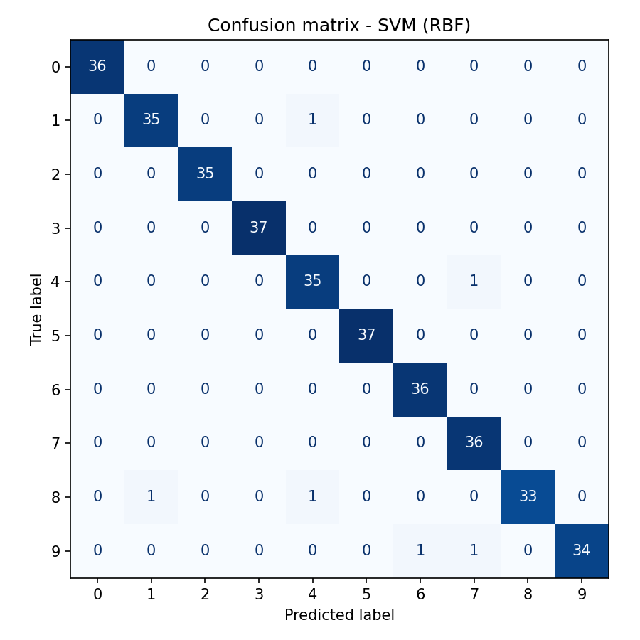
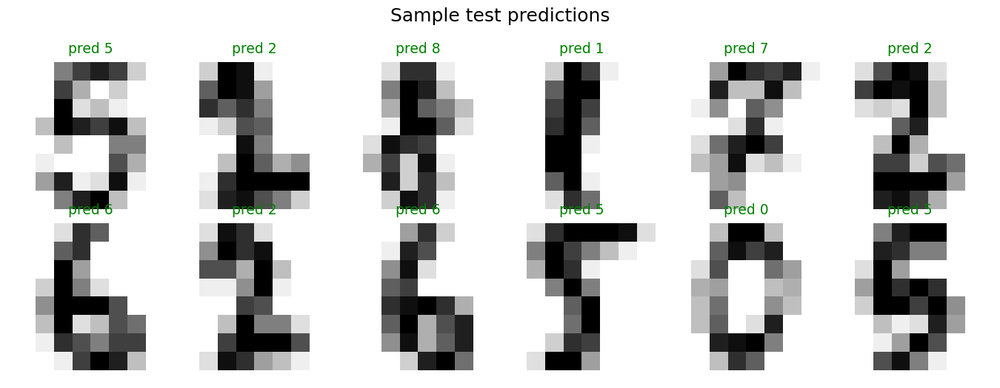

# Handwritten Digit Classifier

A small, reproducible machine-learning project that compares four classic classifiers on the
[scikit-learn digits dataset](https://scikit-learn.org/stable/datasets/toy_dataset.html#optical-recognition-of-handwritten-digits-dataset)
(1,797 8x8 grayscale images), tunes each with cross-validated grid search, saves the best one, and
lets you predict digits from your own images.

## Results

Hyperparameters tuned with 5-fold CV on the training split (80%); final scores on a held-out 20% test set.

| Model               | CV accuracy | Test accuracy |
|---------------------|:-----------:|:-------------:|
| **SVM (RBF)**       | **0.983**   | **0.983**     |
| Random Forest       | 0.977       | 0.967         |
| k-Nearest Neighbors | 0.975       | 0.964         |
| Logistic Regression | 0.970       | 0.972         |

The best model is chosen by **CV score, not test score**, so the test set stays an unbiased final check.





## Quick start

```bash
git clone https://github.com/<your-username>/digit-classifier.git
cd digit-classifier
python -m venv .venv && source .venv/bin/activate   # Windows: .venv\Scripts\activate
pip install -r requirements.txt

python train.py                    # trains, tunes, saves model + plots (~20s)
python predict.py --sample 5       # try the model on random dataset samples
python predict.py my_digit.png --invert   # predict from your own image
pytest                             # run tests
```

`--invert` is for the common case of dark ink on a white background; the dataset has bright
strokes on a dark background.

## Project structure

```
train.py          # data split, grid search, model selection, plots
predict.py        # CLI inference (image file or dataset samples)
tests/            # smoke tests
reports/          # metrics.json and generated figures
models/           # saved model (git-ignored, regenerate with train.py)
```

## Ideas for extending it

- Swap in the full 28x28 MNIST dataset and add a small CNN (PyTorch/Keras) for comparison
- Add a Streamlit or Gradio drawing canvas for live predictions
- Track experiments with MLflow or Weights & Biases
- Add data augmentation (shifts/rotations) and measure the impact

## License

MIT
